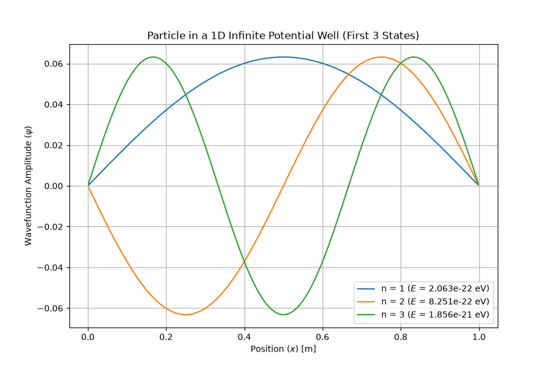
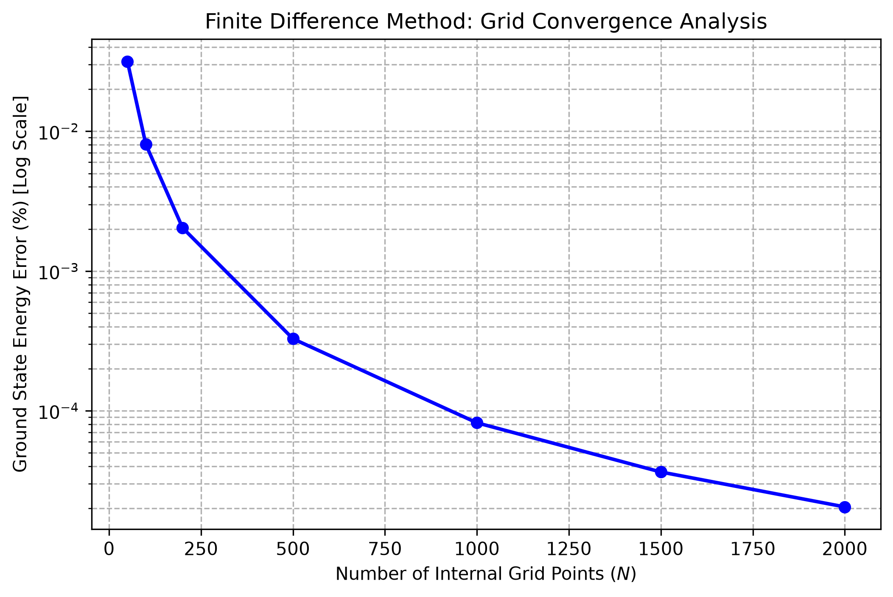
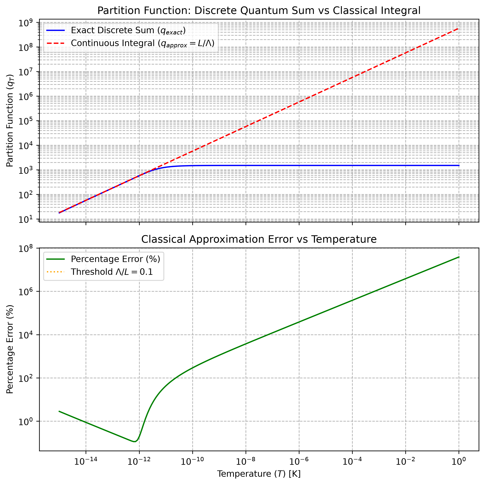

# 1D Quantum Confined Systems & Statistical Mechanics Engine

A rigorous numerical framework developed in Python to solve the time-independent Schrödinger equation via the Finite Difference Method (FDM), validate discretization convergence, and investigate the breakdown of classical phase-space approximations in quantum statistical mechanics.

---

## 🔬 Project Overview
This repository implements a first-principles computational pipeline designed to explore quantum confinement and thermodynamics:
1. **Quantum Solver**: Computes exact eigenvalues and eigenvectors for a particle in a 1D infinite potential well using matrix diagonalization of the finite difference Hamiltonian.
2. **Numerical Verification**: Performs a systematic grid convergence study to mathematically prove discretization stability and error scaling on a log-scale.
3. **Statistical Mechanics Bridge**: Compares exact discrete quantum partition sums against continuous classical approximations, identifying the exact temperature threshold ($\Lambda/L \geq 0.1$) where classical models fail.

---

## 🛠️ Technical Stack
* **Language**: Python 3.x
* **Core Libraries**: `NumPy` (matrix operations & array handling), `SciPy` (physical constants & sparse solvers), `Matplotlib` (publication-grade visualization)
* **Execution Environment**: Windows PowerShell / VS Code Terminal

---

## 📊 Key Results & Visualizations

### 1. Quantum Wavefunctions & Energy Levels
* **Script**: `quantum_solver.py`
* **Description**: Solves the 1D Schrödinger equation, outputting normalized wavefunctions and verified energy eigenvalues.


### 2. Grid Convergence Study
* **Script**: `convergence_study.py`
* **Description**: Demonstrates numerical stability and discretization error bounds on a log-scale across varying grid resolutions.


### 3. Statistical Mechanics Breakdown Analysis
* **Script**: `stat_mech_analysis.py`
* **Description**: Compares the exact discrete partition sum ($q_{exact} = \sum e^{-\beta E_n}$) with the continuous classical approximation ($L/\Lambda$). Highlights the quantum freeze-out regime and flags the thermal cutoff threshold ($\Lambda/L \geq 0.1$).


---

## 🚀 Getting Started & Execution

To replicate these simulations locally, clone the repository and run the scripts via your terminal:

```powershell
# Clone or navigate to the project directory
cd "C:\path\to\your\project"

# Run the quantum solver engine
python quantum_solver.py

# Run the grid convergence verification study
python convergence_study.py

# Run the statistical mechanics analysis
python stat_mech_analysis.py